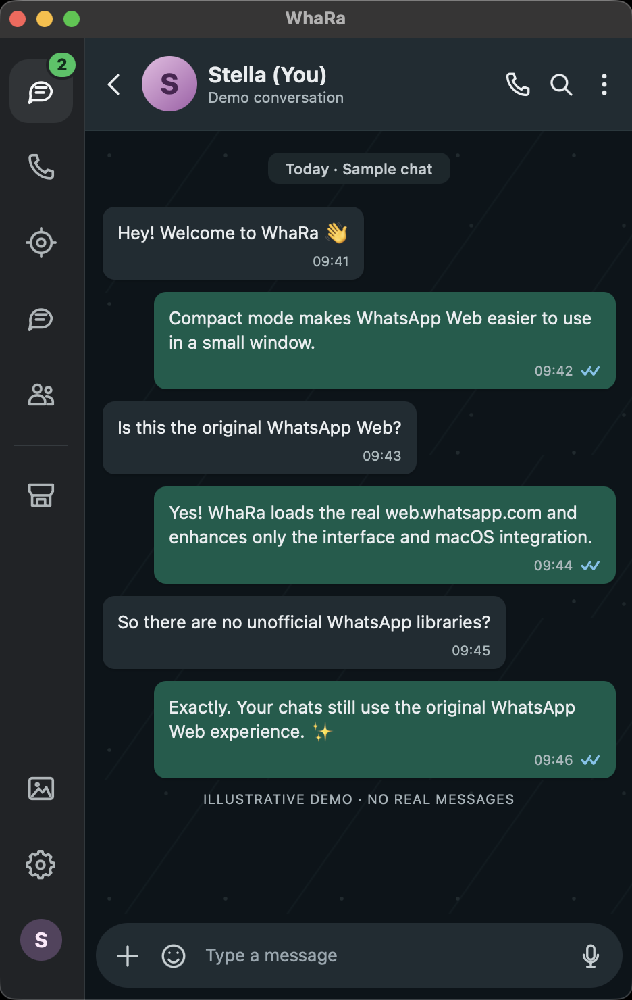

# WhaRa

**The original WhatsApp Web, in a lightweight native macOS window.**  
Rust · Tauri 2 · WKWebView · macOS 12+

WhaRa keeps the familiar WhatsApp Web experience and adds a macOS-friendly shell, a compact single-pane layout, and a few convenient UI controls. It is built for people who want to use WhatsApp Web in its own desktop window without Electron.

  

Compact mode (470 × 740 window). All names, avatars, messages, and counts in this staged screenshot are <strong>synthetic demo data</strong> — no personal conversations are shown.

## Original WhatsApp Web — not an unofficial WhatsApp library

**WhaRa loads [web.whatsapp.com](https://web.whatsapp.com/) directly in macOS WKWebView.** WhatsApp Web itself handles login, QR linking, conversations, media, and supported calling features.

- **No unofficial WhatsApp client library**, reverse-engineered messaging protocol, or alternative WhatsApp backend.
- **No reimplementation of the chat engine.** WhaRa applies scoped, reversible JavaScript/CSS UI enhancements to the WhatsApp Web page and bridges certain desktop features to native Rust/Tauri functionality.
- Native WhatsApp controls still perform the actual WhatsApp actions. For example, the combined Voice/Video menu forwards clicks to WhatsApp's own call buttons.

This is an **independent third-party macOS wrapper**, not an official WhatsApp or Meta application, and is not affiliated with or endorsed by either company.

## Features

### Compact / mobile-like layout

- **Responsive single-pane mode** below 800 CSS pixels: the chat list and the selected conversation take turns occupying the available space.
- **470 × 740 minimum window size**, inspired by Telegram's compact window dimensions.
- **Back-to-chats navigation** when viewing a conversation in compact mode.
- **Compact Contact / Group info** that overlays the conversation instead of breaking the layout into oversized desktop panes.
- **Media, Links & Docs** navigation inside the compact details view, plus support for WhatsApp's native photo viewer.
- **Better chat width and message spacing** for narrow windows; full desktop layout remains available at larger sizes.

### WhatsApp UI conveniences

- **Combined call menu** with the original WhatsApp Voice and Video icons and their native actions.
- **Add to list** shortcut moved to the sidebar for compact navigation, with the native list menu opening alongside it.
- **Original WhatsApp Media sidebar action** retained.
- Changes are restricted to the UI layer; WhatsApp's message list and native actions remain owned by WhatsApp Web.

### macOS integrations

- **Native WKWebView** shell using Rust and Tauri 2 — no Electron.
- **Menu-bar / tray access** with an unread counter and quick actions.
- **Native notifications** bridged from WhatsApp Web to macOS Notification Center.
- **Privacy veil** that can blur chat contents when the window is not focused, with a configurable global shortcut (default: Cmd+Shift+B).
- **Native WebView zoom** from 0.6× to 2×, avoiding CSS zoom interference with WhatsApp's layouts.
- **Launch at login**, **single instance**, **window geometry restoration**, and **keep running in the menu bar** when the chat window is closed.
- **Preferences window** with auto-saved settings.

## Getting started

**Requirements:** macOS 12+, a recent stable Rust toolchain (Rust 1.82 or newer), and Tauri CLI v2. You'll link your WhatsApp account through WhatsApp Web's own login flow.

Install the Tauri CLI if you don't already have it:

~~~bash
cargo install tauri-cli --version "^2" --locked
~~~

Run from the repository root:

~~~bash
cargo tauri dev --no-watch --config src-tauri/tauri.conf.json
~~~

Or build a native executable:

~~~bash
cargo build --release --manifest-path src-tauri/Cargo.toml
./target/release/whara
~~~

To create a macOS app bundle on your own machine:

~~~bash
cargo tauri build --config src-tauri/tauri.conf.json
~~~

**Note:** The GitHub source repository does not ship a prebuilt release bundle. A packaged app or DMG may be published separately after release testing.

## How it works

~~~text
WhaRa (Rust / Tauri)
└── macOS WKWebView ── https://web.whatsapp.com/
    ├── WhatsApp Web's own chat, media, login, and controls
    ├── whara-inject.js  — native notifications, unread title, privacy veil
    └── whara-ui.js      — reversible compact layout and UI proxies
~~~

The JavaScript injected by WhaRa runs inside the loaded WhatsApp Web document. The native shell provides window management, preferences, tray integration, zoom, notifications, and startup behavior. **It does not replace WhatsApp Web's transport or messaging implementation.**

Most UI customization can be disabled independently at runtime for debugging:

~~~js
__wharaUi.setEnabled('compact', false);
__wharaUi.setEnabled('lists', false);
__wharaUi.setEnabled('calls', false);
// __wharaUi.destroy(); // remove the injected UI layer
~~~

These flags reset when the app restarts.

### Project layout

~~~text
prefs/index.html                   Native settings interface
scripts/make-icons.py              App / tray icon generator
src-tauri/src/                     Rust shell, tray, notifications, preferences
src-tauri/resources/whara-inject.js Notification / privacy bridge
src-tauri/resources/whara-ui.js     Compact layout + WhatsApp UI proxies
src-tauri/capabilities/            Tauri permissions
src-tauri/icons/                   App and tray icons
docs/screenshots/                  Privacy-safe demonstration screenshots
~~~

## Tests

~~~bash
cargo test --manifest-path src-tauri/Cargo.toml
cargo fmt --manifest-path src-tauri/Cargo.toml --check
~~~

The injected JavaScript can also be checked with a JavaScript parser. Runtime UI behavior should be verified on macOS because WhatsApp Web updates its private DOM independently of this project.

## Limitations and privacy

- WhatsApp Web is a changing third-party website. Internal DOM selectors and layout behavior can change without notice, so compact UI enhancements may need maintenance.
- Calling and other WhatsApp features depend on what the underlying WhatsApp Web session and WKWebView support.
- WhaRa is **not** a separate WhatsApp service and does not provide an unofficial messaging API.
- The README screenshot is a **staged, illustrative UI preview** containing only synthetic messages in *Stella (You)*. It is not a capture of anyone's real messages or contact list.

## License

MIT — see [LICENSE](LICENSE).
