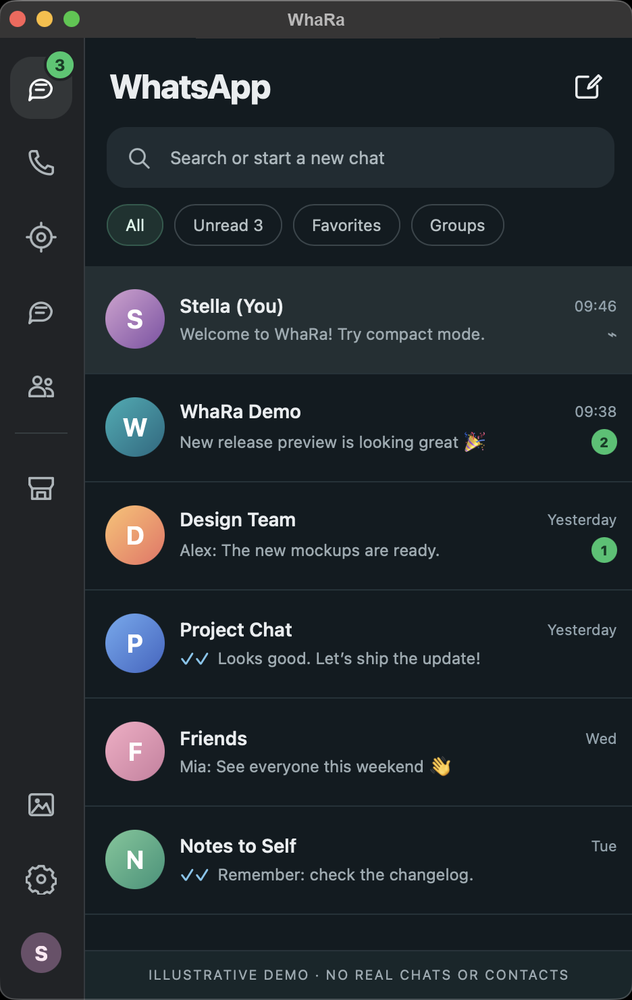

<p align="center">
  
</p>

<h1 align="center">WhaRa</h1>

<p align="center"><strong>The original WhatsApp Web, with a native macOS feel.</strong></p>

<p align="center">
  A lightweight macOS app that wraps the real WhatsApp Web in WKWebView, adds a Telegram-inspired compact layout, and integrates with your Mac. No Electron, no unofficial WhatsApp client library.
</p>

<p align="center">
  <a href="https://github.com/rayenking/WhaRa/actions/workflows/ci.yml"></a>
  <a href="https://github.com/rayenking/WhaRa/releases/latest"></a>
  <a href="https://github.com/rayenking/WhaRa/releases"></a>
  
  <a href="LICENSE"></a>
</p>

<p align="center">
  <a href="https://github.com/rayenking/WhaRa/releases/latest">Download</a> ·
  <a href="#features">Features</a> ·
  <a href="#install">Install</a> ·
  <a href="#build-from-source">Build from source</a> ·
  <a href="https://github.com/rayenking/WhaRa/issues">Report an issue</a>
</p>

## Why WhaRa?

WhatsApp Web works in a browser, but you may want a dedicated window that feels at home on your Mac—especially when you keep messaging beside other apps.

- **Real WhatsApp Web.** WhaRa opens [web.whatsapp.com](https://web.whatsapp.com/) directly. WhatsApp handles QR login, messages, groups, media, and supported calls.
- **Not an unofficial WhatsApp client.** No alternative messaging library, reverse-engineered WhatsApp protocol, or separate backend. WhaRa only injects UI enhancements and connects macOS features.
- **Compact when you need it.** A Telegram-inspired single-pane layout helps the chat list and conversation fit into a smaller window.
- **A proper Mac window.** Menu-bar controls, unread counts, notifications, global shortcut, window restoration, and launch at login.
- **Small and open source.** Rust + Tauri 2 + the system WKWebView, not a bundled Electron/Chromium runtime.

WhaRa is an **independent third-party app**, not an official WhatsApp or Meta product, and is not affiliated with or endorsed by either company.

## A look around

| Compact chat list | Compact conversation |
| :---: | :---: |
|  |  |
| Chat previews, filters, and sidebar | One chat at a time, with familiar WhatsApp actions |

<p align="center"><sub>Shown at approximately 470 × 740. <strong>Both screenshots use synthetic demo names, avatars, messages, timestamps, and unread counts.</strong> No personal conversations or contacts were included.</sub></p>

## Features

### WhatsApp Web, kept original

- Sign in by scanning the QR code with WhatsApp on your phone.
- Use WhatsApp Web's own conversations, groups, media, and supported controls.
- WhaRa's injected JavaScript/CSS changes the **interface only**; it does not replace WhatsApp's messaging engine.
- UI changes are designed to be scoped and reversible.

### Compact mode

- Responsive single-pane navigation below approximately 800 CSS pixels, with a **470 × 740 minimum window**.
- Chat list and conversation adapt when you resize the window.
- Back button to return to the chat list.
- Contact and group details, plus **Media, Links & Docs**, work in the compact layout.
- Conversation bubbles and spacing are adjusted for narrow windows.
- Sidebar access to **Add to list** and WhatsApp's media section.
- Combined **Voice / Video** call dropdown, forwarding to the original WhatsApp actions.

### On your Mac

- Native macOS WKWebView app; no Electron.
- Menu-bar icon with unread counter and quick actions.
- macOS notifications.
- Optional privacy veil that blurs chats when the window is unfocused; default shortcut: **⌘ Shift B**.
- Native WebView zoom (0.6×–2×), without CSS zoom hacks that disrupt virtualized lists.
- Open at login, remember window geometry, and keep running in the menu bar after closing the chat window.
- Separate Preferences window for desktop options.

### In-app updates (v0.2.0 and newer)

- Checks after launch and about every six hours.
- An **Update / Later** dialog when a newer release is detected.
- Clicking **Update** downloads the signed package, shows progress, installs it, and restarts WhaRa.
- **Later** snoozes the prompt for around 24 hours; **Check now** is available in Preferences.
- Updater archives are verified with a signing key before installation.

## Install

Get WhaRa from the [latest GitHub release](https://github.com/rayenking/WhaRa/releases/latest):

| Mac | Download |
| --- | --- |
| macOS 12+, Apple Silicon (M-series) | [`WhaRa_vX.Y.Z_apple-silicon.dmg`](https://github.com/rayenking/WhaRa/releases/latest) |
| macOS 12+, Intel | [`WhaRa_vX.Y.Z_intel.dmg`](https://github.com/rayenking/WhaRa/releases/latest) |

1. Download the **DMG** for your Mac.
2. Open it and drag **WhaRa.app** into **Applications**.
3. Open WhaRa and link your WhatsApp account with its QR code.

The release also provides `.app.zip` downloads and `SHA256SUMS.txt` for verification. Files ending in `.app.tar.gz`, `.sig`, and `latest.json` are used by the in-app updater; **you don't need to download them manually**.

> **Existing v0.1.0 users:** this version predates the in-app installer. Upgrade to **v0.2.0 or newer once via DMG**; subsequent releases can update within WhaRa. Check [Releases](https://github.com/rayenking/WhaRa/releases) for what's actually published.

### The first launch

**macOS:** WhaRa is currently ad-hoc signed but **not notarized by Apple**, so Gatekeeper may warn that Apple cannot check the app for malicious software.

The recommended way to allow the app is:

1. Try opening **WhaRa.app** from Applications once.
2. Open **System Settings → Privacy & Security**.
3. Scroll to **Security**, find the blocked WhaRa entry, and click **Open Anyway**.
4. Confirm, then open WhaRa normally next time.

Alternatively, if you **downloaded WhaRa from the official repository and trust the file**, you can remove macOS's downloaded-file quarantine attribute once in Terminal:

```sh
xattr -dr com.apple.quarantine /Applications/WhaRa.app
```

This command **bypasses macOS's first-launch quarantine check** for that app. Use the **Open Anyway** method when possible; do not run the command for downloads from unknown sources.

The QR sign-in screen is WhatsApp Web itself. On your phone, open **WhatsApp → Linked devices → Link a device** and scan the QR code.

### Updates after installation

From **v0.2.0 onward**, WhaRa checks GitHub Releases for newer signed versions. Choose **Update** to download, install, and reopen WhaRa, or **Later** to continue chatting. Automatic installation **never starts without your click**.

For a manual check, use **WhaRa Preferences → Check now**. If an update cannot be downloaded or verified, your current app remains the version to use; check the official release page if you need a manual installer.

## Troubleshooting

- **macOS won't open the app:** follow [The first launch](#the-first-launch), then confirm the app was placed in `/Applications`.
- **QR code or WhatsApp Web doesn't load:** check your connection, try re-opening WhaRa, and make sure your macOS version supports the current WhatsApp Web.
- **The layout looks wrong:** resize the window to switch between compact and desktop views; WhatsApp may change its web interface independently, requiring UI compatibility fixes.
- **Calling doesn't work:** WhaRa forwards to WhatsApp's native web controls. Actual calling availability depends on WhatsApp Web and WKWebView support.
- **No update popup:** v0.1.0 needs a manual upgrade first. Debug/development builds don't run the production installer. Use Preferences → Check now on a packaged v0.2.0+ build.
- **Update download or signature check fails:** do not install files from untrusted mirrors. Retry later or download the official DMG from [Releases](https://github.com/rayenking/WhaRa/releases).

Found a reproducible bug? [Open an issue](https://github.com/rayenking/WhaRa/issues), ideally with the WhaRa version, macOS version, window dimensions, and **privacy-safe** screenshots (no real chats).

## Build from source

You'll need **macOS 12 or later**, **Rust 1.90+**, and **Tauri CLI v2**. Release installers are prebuilt; these steps are only for contributors or people building locally.

```sh
git clone https://github.com/rayenking/WhaRa.git
cd WhaRa

cargo install tauri-cli --version "^2" --locked
cargo tauri dev --no-watch --config src-tauri/tauri.conf.json
```

To compile the native Rust executable:

```sh
cargo build --release --manifest-path src-tauri/Cargo.toml
```

Release packaging enables **signed updater artifacts** and therefore requires the private signing key. This is only needed by maintainers producing official updates—not by people running from source.

### Tests

```sh
cargo fmt --manifest-path src-tauri/Cargo.toml --check
cargo test --locked --manifest-path src-tauri/Cargo.toml
python3 -m unittest discover -s scripts -p 'test_*.py'
```

WhatsApp Web owns its DOM and may change it over time, so compact layout changes should also be checked in a running macOS WKWebView.

## How it works

```text
WhaRa (Rust / Tauri 2)
├── macOS native window, tray, notifications, and preferences
├── Signed in-app updater (local window only)
└── WKWebView → https://web.whatsapp.com/
    ├── Original WhatsApp Web messaging and controls
    ├── whara-inject.js  → unread count, privacy, notifications
    └── whara-ui.js      → reversible compact UI enhancements
```

WhaRa does **not** log in through an unofficial WhatsApp API or proxy messages through a custom server. It embeds the website. The injected UI follows that website's evolving markup and cannot guarantee every native WhatsApp feature will be available in WKWebView.

### Project layout

```text
prefs/                         Preferences + Update / Later window
src-tauri/src/                 Native Rust shell, tray, updater, settings
src-tauri/resources/           JavaScript injected into WhatsApp Web
src-tauri/capabilities/        Tauri command permissions
src-tauri/icons/               App and menu-bar icons
docs/screenshots/              Synthetic, privacy-safe screenshots
scripts/                       Build helpers and updater-manifest tests
.github/workflows/             CI and macOS release builds
```

### Maintainers: publishing releases

A `vX.Y.Z` tag runs GitHub Actions to test and build DMG, `.app.zip`, **signed updater archives** (Apple Silicon and Intel), SHA-256 checksums, and the `latest.json` update feed.

The updater's **public** signing key is in the Tauri config. The **private** key must never be committed or uploaded as a release asset; CI uses the repository Actions secret `TAURI_SIGNING_PRIVATE_KEY`. Keep a secure backup of the original key because existing installs trust it for future updates.

Update the version in both `src-tauri/Cargo.toml` and `src-tauri/tauri.conf.json` before pushing a matching release tag. The workflow publishes downloads only after both architecture builds succeed.

## Privacy, scope & limitations

- The screenshots above are **entirely synthetic** and do not show real contacts or messages.
- WhatsApp Web is a third-party website; messages, login, and session behavior remain subject to WhatsApp's service and policies.
- WhaRa changes the web UI and integrates macOS features; it does not replace the WhatsApp protocol.
- UI selectors, media views, and responsive layout may need maintenance when WhatsApp updates its website.
- WhaRa currently targets **macOS only**.

## License

MIT — see [LICENSE](LICENSE).
